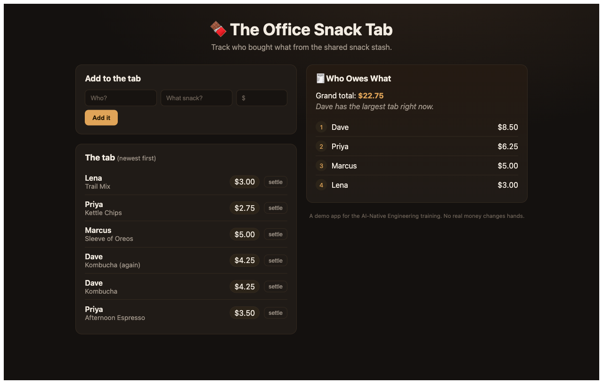

# 🍫 The Office Snack Tab (front-end only)

Track the team's shared snack and coffee purchases. Add what you took, see the running tab, and check the **Who Owes What** per-person totals.

Live at **https://snacktab.bcgxdemos.com**.



This is a pure Angular SPA port of a full-stack Kotlin/Ktor + Angular teaching demo. The original backend was only an in-memory store with no database. All of its logic now runs in the browser in [`SnackTabService`](src/app/core/snack-tab.service.ts). The tab resets on page reload, as the backend reset on restart.

## Stack

| Piece | Tech |
| --- | --- |
| UI | Angular 22, standalone components and signals |
| State | In-memory `Map` in an injectable service |
| Money | BigInt cents, decimal strings at the edges. No floats. |
| Tests | Vitest via `ng test` |
| Hosting | GitHub Pages, deployed by GitHub Actions |

## Run it

Node version is pinned in `.node-version`.

```bash
npm ci
npm start                    # http://localhost:4200
npx ng test --watch=false    # unit tests
npx ng build                 # production build → dist/frontend/browser
```

## Deploy

Every push to `main` runs [`.github/workflows/deploy.yml`](.github/workflows/deploy.yml). It tests, builds, and publishes to Pages. `public/CNAME` sets the custom domain. The DNS record is a DNS-only CNAME in Cloudflare, `snacktab` → `madmaxlax.github.io`.
